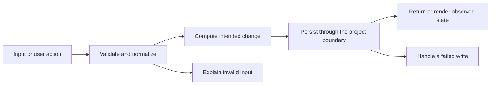

# Codebase map and reading order

[Course index](README.md)

## The problem this project solves

Expenses could be added and deleted, but there was no edit action. The shared submit handler also accepted some malformed amounts without useful feedback. The improvement you will study is: The existing modal supports an expense-edit mode with prefilled values, positive finite two-decimal amounts, real calendar dates and nonblank descriptions. Failed validation or storage keeps the original expense and the editor open. Totals continue to be derived from state.

## Data model

The saved document contains expenses, incomes, budgets, bills, goals and investments. An expense has id, owner, date, category, description and amount. Editing changes its fields, not its id or the number of expenses.

An object is a named collection of fields. An array is an ordered collection of values. An id answers “which record?”; an index answers “where is it in this array right now?” Those questions are different whenever the list can be filtered, reordered or edited. Persisted data is the form that must survive a process/page restart. Derived data can be recomputed from that persisted state.

## Trace one action

1. The ledger Edit button passes an expense id.
2. editExpense pre-fills the existing modal and fixes its type to expense.
3. handleEntrySubmit constructs and validates a candidate.
4. A new state replaces only the matching expense while retaining its id.
5. Storage succeeds before state is published.
6. render derives totals and charts from the updated state.

This diagram names responsibilities, not necessarily separate files. A small browser program can keep them in app.js. A larger API spreads them across controllers, services and models. Follow the actual sequence above rather than assuming every repository has the same architecture.

## Where to read first

1. [app.js](../app.js): locate `editExpense` and read its inputs, branches and return/side effects.
2. [test/expense-edit.test.cjs](../test/expense-edit.test.cjs): read the scenario names before the helper code.
3. The root [README](../README.md): connect setup and the larger application workflow.

## Source navigation

- [app.js](../app.js)

## A practical reading technique

At each function boundary, write down the value coming in, the value going out and any side effect. A side effect includes a storage write, SQL query, network request, timer registration or DOM update. If a function calls another function, inspect only that next dependency until you can finish the chosen trace. Return to unrelated files later.

For this lesson, start with: **The fixture contains one $10.00 expense and no paid bills. Edit it to $12.50. There must still be exactly one expense with the same id, monthly spending must be $12.50, and reload must retain $12.50. Trying -1 or 1.001 must leave $10.00 unchanged in a fresh fixture.** Mark where the id, time, amount or other important value changes representation. For example, JSON serializes values into text; a date field may be a calendar string; SQL aggregates may return a different type from individual rows. Representation changes are common bug locations.

## Check your understanding

Without reading the solution, answer: Who owns the mutable state? Which input is untrusted? Which function first decides whether the operation is valid? What survives reload or restart? What observation would prove that the operation partially failed? Point to a source file for each answer, rather than describing a generic app from memory.
